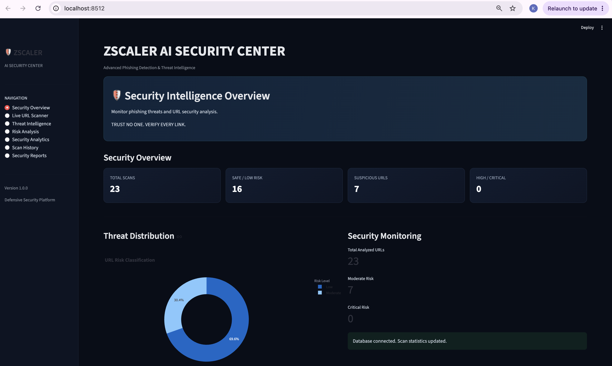
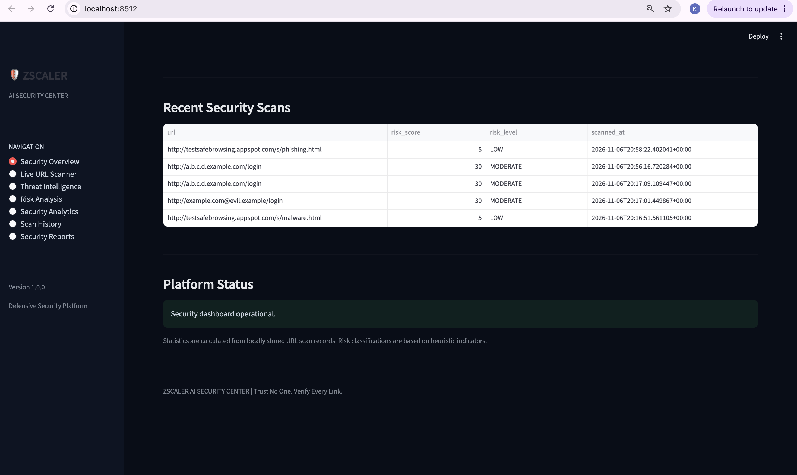
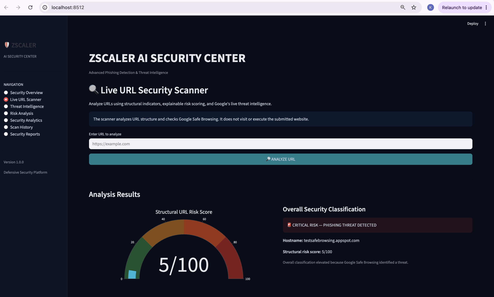
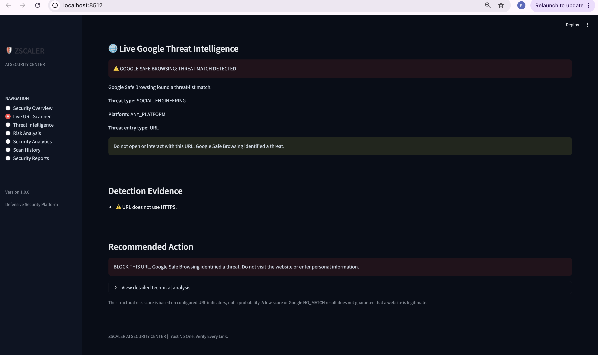
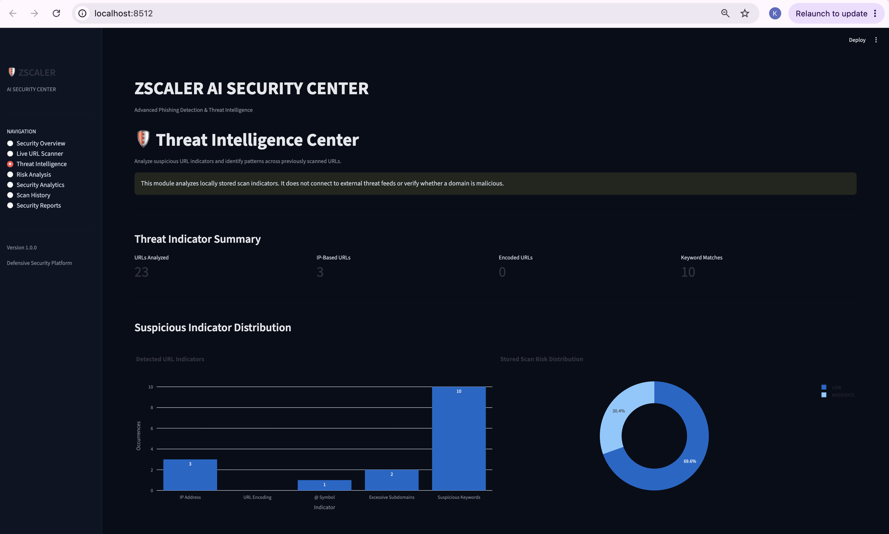
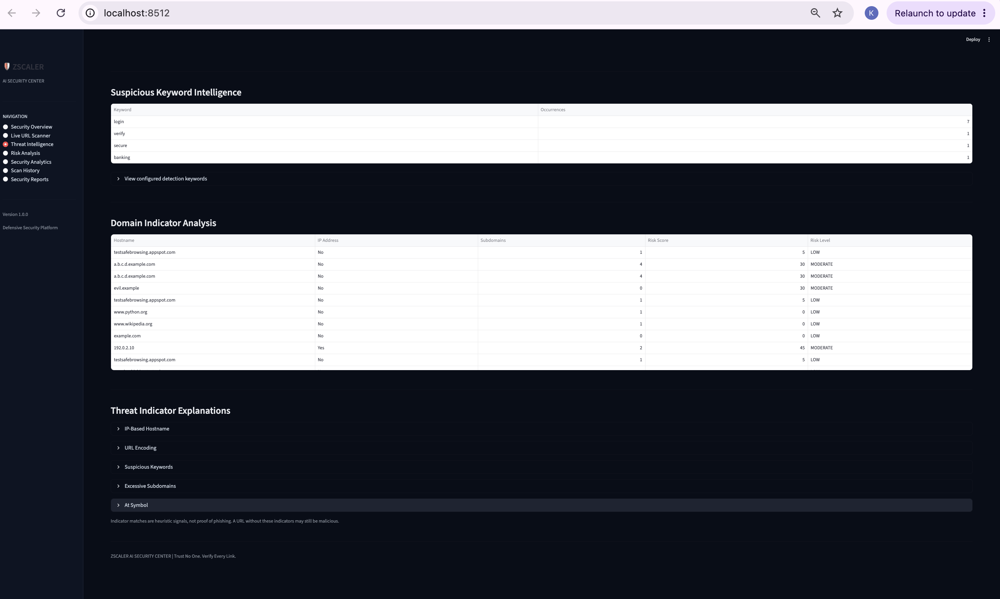
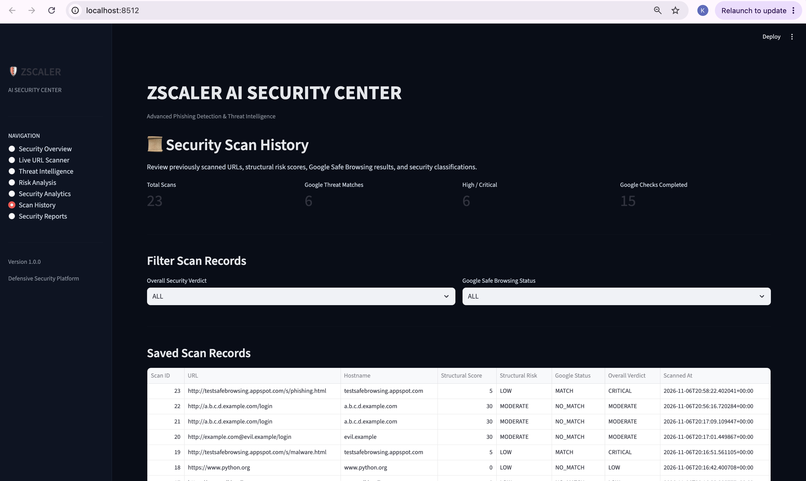
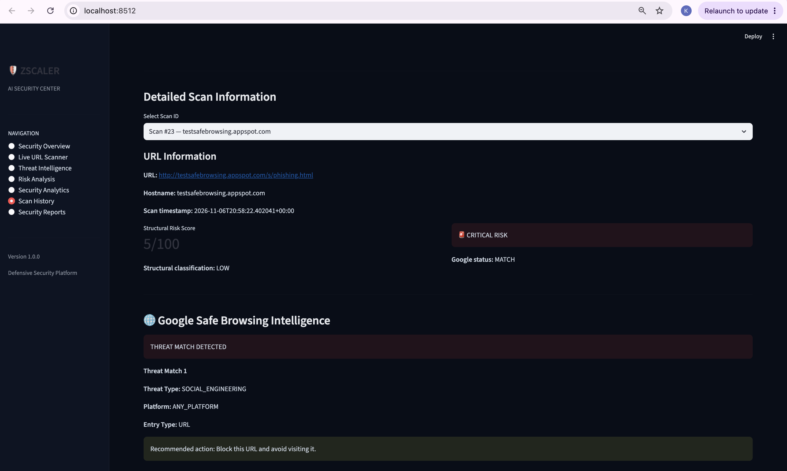
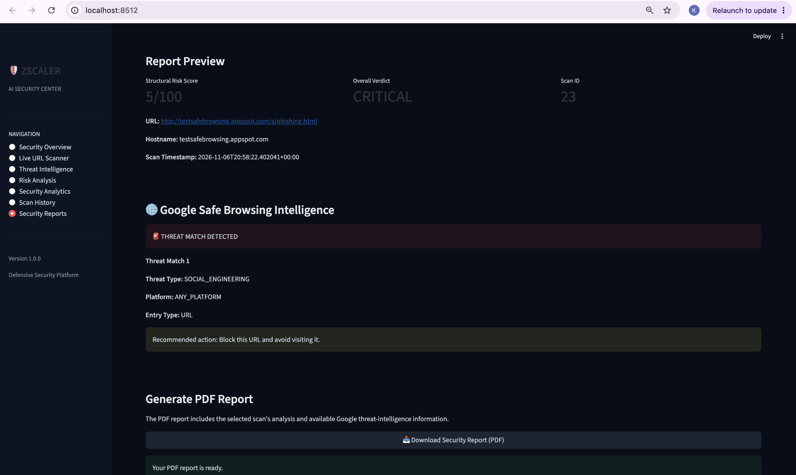
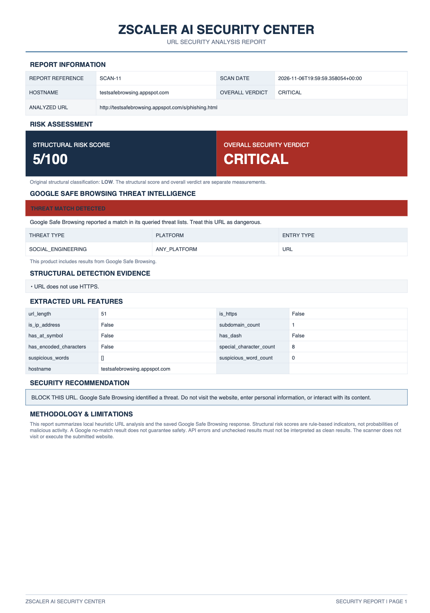

# 🛡️ ZSCALER CYBER GUARDIANS
## AI Security Intelligence Center

**TRUST NO ONE. SECURE EVERY RUN.**

## 🚀 Live Application

<badge>LIVE DEMO</badge>

🌐 **[Launch Zscaler Cyber Guardians – AI Security Intelligence Center](https://kruthika243-zscaler-ai-security-center-app-rso3c5.streamlit.app/)**

The application is deployed using Streamlit Community Cloud. Explore the following features:

- Phishing URL detection and structural analysis
- Rule-based security risk assessment
- Google Safe Browsing threat intelligence
- Security analytics dashboard
- Scan history and PDF security reports

**Project:** INFO 5737 – Information and Cyber-Security  
**Team:** Zscaler Cyber Guardians – Team 6

---

A rule-based cybersecurity application developed as part of the Zscaler Cyber Guardians cricket franchise concept. It analyzes suspicious URLs, identifies potential phishing threats, and provides explainable security risk indicators using structural URL analysis and Google Safe Browsing threat intelligence.

---

## 🏏 Project Overview

The Zscaler AI Security Intelligence Center is an interactive Streamlit application designed to assess URL security risks.

It combines:
- Structural URL analysis
- Explainable rule-based risk scoring
- Google Safe Browsing API integration
- Security analytics and scan history
- PDF security report generation

The application demonstrates how cybersecurity awareness and URL threat detection can help protect users from suspicious links and potential phishing attacks.

**Academic Project:** Zscaler Cyber Guardians – INFO 5737  
**Project Type:** Educational Cybersecurity Demonstration

## 🏏 Cyber Guardians: Matchday Fan Protection Scenario

As part of our fictional Zscaler Cyber Guardians cricket franchise, cybersecurity plays an important role in protecting fans and their digital matchday experiences.

Imagine a fan receives a message claiming to provide match tickets or a ticket verification link for a Cyber Guardians cricket game. The link may lead to a phishing website designed to steal personal information.

Our AI Security Intelligence Center demonstrates how such suspicious URLs can be investigated.

### Demonstration Workflow

1. A fan receives a suspicious match-ticket URL.
2. The URL is submitted to the Live URL Scanner.
3. The application analyzes its structure and suspicious characteristics.
4. Google Safe Browsing checks the URL against known threats.
5. The application displays risk indicators and a security verdict.
6. Scan results can be saved in scan history and exported into a PDF report.

**Purpose:** Demonstrate how cybersecurity awareness and URL threat detection can support safer digital experiences for cricket fans.

*Note: This is a proposed educational scenario created for our academic project. The application is not an official Zscaler product and is not deployed in a real stadium.*

---

## 🔐 Key Features

- URL scanning and structural analysis
- Rule-based phishing risk assessment
- Google Safe Browsing API integration
- Threat intelligence results and threat categories
- Explainable risk indicators
- Interactive security analytics dashboard
- SQLite-based scan history
- PDF security report generation
- CSV export of scan results

## 🔐 Cybersecurity and Zero Trust Connection

The project is inspired by the Zero Trust security approach:

- **Never Trust Automatically:** Suspicious URLs are analyzed rather than automatically trusted.
- **Verify Every Link:** URL structure and available threat intelligence are checked.
- **Identify Potential Threats:** Rule-based analysis highlights suspicious URL characteristics.
- **Provide Explainable Results:** Users can review the indicators contributing to the risk assessment.
- **Maintain Security Records:** Scan history supports review and security awareness.

The application demonstrates selected cybersecurity concepts inspired by Zero Trust. It is not a complete Zero Trust security platform.

---

## 💻 Technology Stack

- Python
- Streamlit
- Pandas
- SQLite
- Google Safe Browsing API
- Requests
- ReportLab

## 📂 Project Architecture

```text
ZSCALER_AI_SECURITY_CENTER/
├── app.py
├── assets/
├── config/
├── core/
├── database/
├── modules/
├── tests/
├── utils/
├── requirements.txt
└── README.md
```

---

## ⚙️ Installation

Clone the repository:

```bash
git clone https://github.com/kruthika243/ZSCALER_AI_SECURITY_CENTER.git
cd ZSCALER_AI_SECURITY_CENTER
```

Create and activate a virtual environment:

```bash
python3 -m venv .venv
source .venv/bin/activate
```

Install dependencies:

```bash
pip install -r requirements.txt
```

## 🔑 Google Safe Browsing Configuration

Create:

`.streamlit/secrets.toml`

Add your Google Safe Browsing API key:

```toml
GOOGLE_SAFE_BROWSING_API_KEY = "YOUR_API_KEY"
```

Never commit your API key or secrets file to GitHub.

## ▶️ Run the Application

```bash
streamlit run app.py
```

---

## 📊 Risk Assessment

The application combines structural URL indicators with Google Safe Browsing results.

- Google Safe Browsing matches can identify known threats.
- A `NO_MATCH` response does not guarantee that a URL is safe.
- An API error means the threat-intelligence check is inconclusive.
- The structural risk score is a rule-based assessment, not a machine-learning probability.
- The application does not visit or execute the submitted website.

## 🧪 Project Status

The application includes:

- Rule-based URL analysis
- Google Safe Browsing integration
- Scan history
- Security analytics
- PDF reporting
- CSV export

No machine-learning model training or ML performance evaluation is claimed in this version.

---

## 🖥️ Application Screenshots

### 1. Security Dashboard

The dashboard provides an overview of URL scans, security classifications, threat distribution, and recent scan activity.





### 2. Live URL Scanner

The URL scanner combines structural URL analysis, explainable risk scoring, and Google Safe Browsing threat intelligence.





### 3. Threat Intelligence

This module analyzes stored URL indicators, suspicious keywords, domain characteristics, and risk distributions.





### 4. Security Scan History

Review saved URL scans, structural risk scores, Google Safe Browsing results, and overall security verdicts.





### 5. PDF Security Report

The application generates downloadable PDF reports containing URL analysis, threat intelligence, detection evidence, and security recommendations.





---

## 🎬 Live Application Demonstration

The application includes seven main modules:

1. Security Overview
2. Live URL Scanner
3. Threat Intelligence
4. Risk Analysis
5. Security Analytics
6. Scan History
7. Security Reports

During the project presentation, we demonstrate how a suspicious match-ticket URL can be analyzed, how the results are interpreted, and how scan reports can be generated.

---

## 📚 Technical Documentation

Detailed documentation covering the system architecture, detection methodology, API integration, and testing.

| Document | Description |
|---|---|
| [Project Documentation](docs/PROJECT_DOCUMENTATION.md) | Project overview, objectives, technologies, modules, and limitations |
| [System Architecture](docs/SYSTEM_ARCHITECTURE.md) | Architecture diagram, components, workflow, and data flow |
| [Detection Methodology](docs/DETECTION_METHODOLOGY.md) | URL analysis, rule-based risk scoring, and Google Safe Browsing integration |
| [Testing Documentation](docs/TESTING_DOCUMENTATION.md) | Automated test cases, results, and testing limitations |

---

## ⚠️ Disclaimer

This project is developed for educational and academic demonstration purposes as part of the Zscaler Cyber Guardians university project.

It is not an official Zscaler product or an officially deployed cybersecurity service.

Risk scores and security verdicts are indicators based on rule-based URL analysis and available Google Safe Browsing results. They do not guarantee that a URL is malicious or safe.

Users should exercise caution when interacting with unknown links.

---

**ZSCALER CYBER GUARDIANS**

*TRUST NO ONE. SECURE EVERY RUN.*