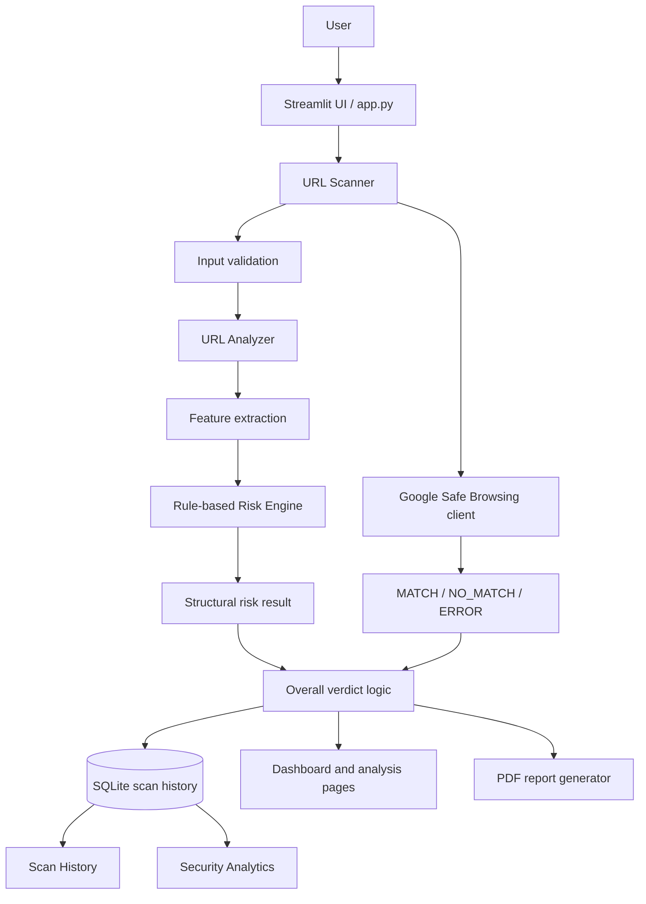

# System Architecture

## 1. Architectural style

The application uses a modular, layered Python structure. Streamlit pages provide the UI; core modules perform URL analysis and rule-based assessment; the threat-intelligence module queries Google Safe Browsing; database modules persist scan results; reporting modules create downloadable reports.

## 2. Logical architecture

## 3. Layers

### Presentation
`app.py` and `modules/` implement Streamlit navigation and pages: dashboard, URL scanner, threat intelligence, risk analysis, security analytics, scan history, and security reports.

### Core analysis
`core/url_analyzer.py` parses URLs and extracts attributes. `core/feature_extractor.py`, `core/risk_engine.py`, and `core/phishing_detector.py` support indicator processing and rule-based assessment. `core/explainability.py` supports explanations.

### External service
`core/google_safe_browsing.py` communicates with Google Safe Browsing. The API result remains distinct from the structural risk score.

### Persistence
`database/db.py` handles database setup/schema operations. `database/scan_history.py` handles scan persistence and retrieval using SQLite.

### Reporting
`modules/report_generator.py` generates PDF reports. `modules/security_reports.py` provides the report interface.

### Configuration and utilities
`config/` contains application settings. `utils/` contains validation and helper functions. `.streamlit/secrets.toml` is local secret configuration and must not be committed.

## 4. Scan sequence

1. User submits a URL through Streamlit.
2. Input validation checks empty input, control characters, and supported URL formats.
3. URL analysis normalizes missing schemes to HTTPS and parses hostname, path, and query.
4. Structural attributes are extracted.
5. The risk engine returns a structural score/classification.
6. Google Safe Browsing lookup is requested.
7. The API outcome is interpreted as MATCH, NO_MATCH, or ERROR.
8. Overall verdict logic combines the signals. A confirmed threat match can override a low structural classification.
9. The result is stored in SQLite and rendered in the UI.
10. The user can inspect history, analytics, and a PDF report.

## 5. Persistence model

The scan-history database stores scan details and the additional fields `google_status`, `google_matches`, and `overall_verdict`. The exact complete schema should be treated as defined by the current `database/db.py` implementation; this document does not invent unverified column types or constraints.

## 6. Trust boundaries and secrets

- User-provided URL text is untrusted input and must be validated.
- Google Safe Browsing is an external dependency; network/API failures differ from a no-match.
- The API key is stored in `.streamlit/secrets.toml`.
- Local secrets and runtime database files should be excluded from Git.
- URL scanning does not require opening the destination website.

## 7. Architectural limitations

This is a local Streamlit application with SQLite persistence. It is not presented as a horizontally scaled production service. Authentication, distributed queues, centralized logging, and multi-tenant access control are not claimed in this version.
